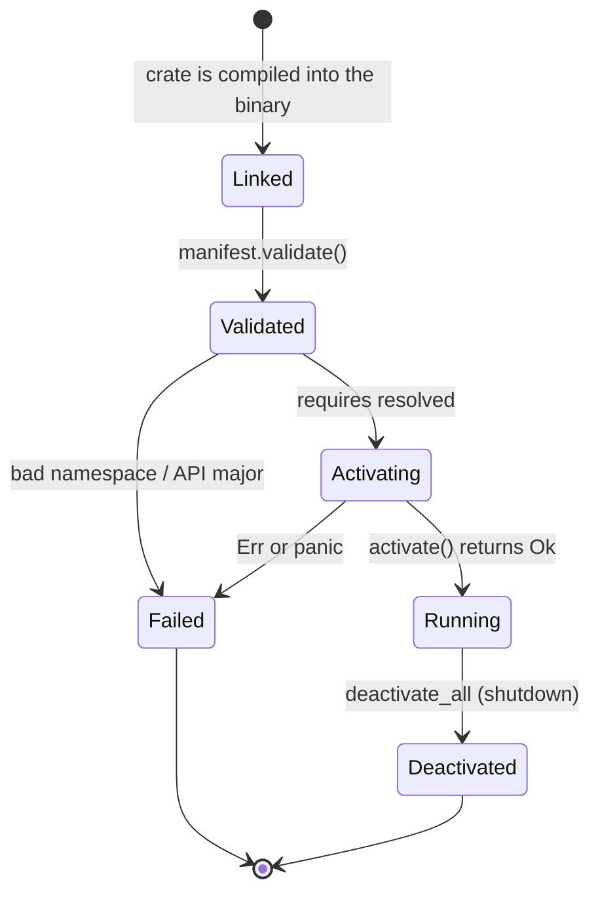
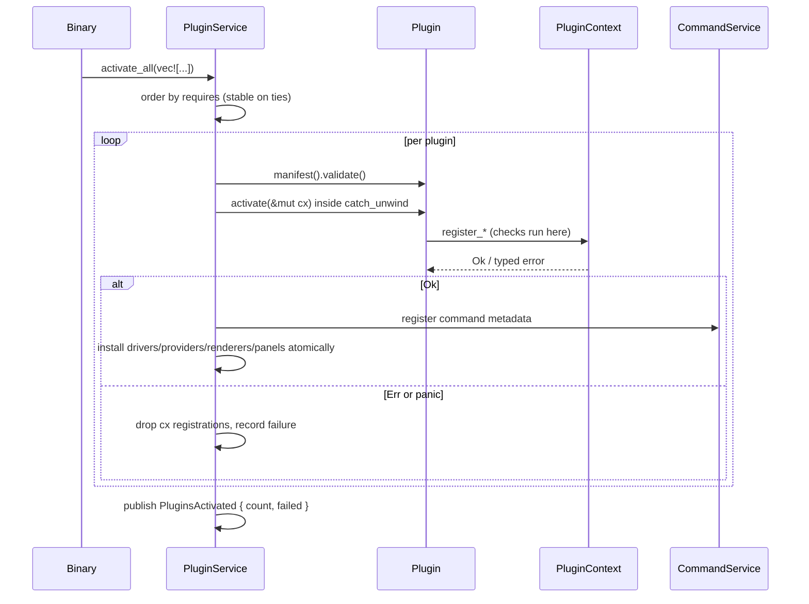

# Plugin API

> Extension points and plugin lifecycle — the contracts that make "everything is extensible" a concrete, testable API surface rather than a slogan.

---

## Purpose

The vision document ([01-vision.md](01-vision.md)) mandates that everything in Tempr is extensible. This document defines what "everything" means concretely. Stage 1 of Phase 4 shipped five extension points; themes arrive in stage 2:

1. **Database drivers** — connect to new engines beyond the PostgreSQL driver (`dev.tempr.postgres`).
2. **Completion providers** — inject custom candidates into the SQL completion pipeline.
3. **Commands** — register new actions in the command palette and bind keybindings.
4. **Result renderers** — provide specialized cell rendering for columns the built-in formatter does not serve.
5. **Panels** — contribute custom panels to the workspace dock (rendered by the stage-3 dock).
6. **Themes** *(stage 2)* — supply color schemes and font settings as data.

AI providers are **not** in the v1 API (see "Not in the shipped API" below).

Every core feature in Tempr uses the same registration path a third-party plugin does: the PostgreSQL driver is a plugin, and `plugins/export-csv` is both a reference and a test of the public surface. This "eat your own plugin API" policy is what keeps the surface honest.

---

## Responsibilities

This document governs:

- The `Plugin` root trait that every plugin implements.
- The `PluginManifest` metadata structure (id, name, version, declared capabilities).
- The `PluginContext` that plugins receive during activation — the only surface through which plugins interact with the host.
- Each extension-point contract: `DatabaseDriver` (re-exported from `tempr_db`), `CompletionProvider`, `ResultRenderer`, `Panel`, and `PluginCommandSpec`; `register_theme(ThemeData)` joins them in stage 2.
- Plugin lifecycle: discovery, activation, running, deactivation, and failure states.
- The v1 static-plugin delivery model and the rationale for deferring dynamic loading.
- The security boundary: plugins never receive access to the `ServiceRegistry`.

This document does **not** govern:

- The `EventBus` or `AppEvent` taxonomy (see [06-event-system.md](06-event-system.md)).
- The `ServiceRegistry` or service lifecycle (see [05-services.md](05-services.md)).
- Plugin UI rendering conventions (see [11-gpui.md](11-gpui.md)).
- Individual driver, completion, or rendering implementation details — those live in their respective domain documents.

---

## Design Rationale

### Registration-Based vs Hook-Based

Two fundamental plugin architectures exist:

| Model | How it works | Tradeoff |
|---|---|---|
| **Hook-based** | Host defines named hook points (`on_query_execute`, `on_render_cell`). Plugins register closures for each hook. | Simple to implement; creates implicit ordering problems; hard to audit which plugins touch which hooks; hook signature changes break every plugin. |
| **Registration-based** | Host defines typed extension-point traits. Plugins receive a `PluginContext` and call `register_*` methods to hand capabilities to the host. The host controls when and how those capabilities are invoked. | Clean ownership (host owns the capabilities); typed contracts enforced at compile time; easy to audit (grep for `register_` calls); signature changes produce compile errors, not runtime failures. |

Tempr uses the **registration-based** model. During activation, a plugin receives a mutable `PluginContext` and calls registration methods to hand its capabilities to the host. The host stores these capabilities and invokes them at the appropriate time — a completion request, a render call, a command execution. The plugin never calls into the host beyond registration and event access.

### Why Plugins Never Get `ServiceRegistry` Access

The `ServiceRegistry` (see [02-architecture.md](02-architecture.md)) provides access to every service in the system. Giving plugins this access would:

1. **Break API stability.** Every internal service method change would become a breaking change for every plugin. The `PluginContext` registration surface is intentionally narrow — changes to it are rare, well-reviewed, and versioned.
2. **Enable uncontrolled side effects.** A plugin with `ServiceRegistry` access could call any service method, subscribe to any event, and mutate shared state in ways the host cannot reason about. Registration-based APIs limit plugins to a well-defined interaction surface.
3. **Block the sandboxing path.** Future dynamic loading (WASM or process isolation) requires a capability boundary. If the v1 static API leaks `ServiceRegistry` access, migrating to dynamic plugins means breaking every plugin that uses it. The narrow `PluginContext` surface today preserves the option to sandbox tomorrow.

The one exception is `PluginContext::events()`, which returns a reference to the `EventBus`. Plugins may subscribe to and publish events (including their own namespaced `PluginEvent` variants) but cannot access services directly. This gives plugins the observability and communication channel they need without exposing internal service internals.

### Why Core Features Use the Plugin API

Implementing the PostgreSQL driver, the built-in themes, and the default result renderers as static plugins has three benefits:

1. **Dogfooding.** If the plugin API cannot express a first-class feature, it is insufficient for third-party plugins. Every pain point a core feature hits is a pain point a future plugin author would hit.
2. **Consistency.** Core and third-party plugins share the same activation path, the same `PluginContext`, and the same registration semantics. There are no "special" code paths for built-in features.
3. **Testability.** Each static plugin is a self-contained crate that can be tested independently against the plugin API contracts.

---

## Interfaces

These signatures are the shipped `tempr_plugin` surface (crates/tempr_plugin).
Everything a plugin names comes from that crate, including the GPUI and driver
types it re-exports; a plugin never depends on `tempr_services`, `tempr_ui`,
`tempr_intel` or `tempr_editor`.

### Plugin Manifest

```rust
pub const PLUGIN_API_VERSION: (u16, u16) = (0, 1);

pub struct PluginManifest {
    pub id: &'static str,              // reverse-domain, unique: "dev.tempr.postgres"
    pub name: &'static str,            // human-readable: "PostgreSQL driver"
    pub version: &'static str,         // the plugin's own version, unrelated to the API
    pub api_version: (u16, u16),       // the API the plugin was written against
    pub requires: &'static [&'static str], // plugin ids that must activate first
    pub capabilities: &'static [Capability],
}

pub enum Capability {
    Driver { engine: &'static str },
    CompletionProvider,
    Theme,
    CommandContribution,
    PanelContribution,
    ResultRenderer,
}
```

`id` must be a lowercase reverse-domain namespace (at least two dot-separated
segments of `a-z`, `0-9`, `-`). Command and panel ids are namespaced with it:
`dev.tempr.export-csv::export_last_run`. `PluginManifest::validate` rejects a
malformed id and an API-major mismatch with a typed `PluginError`.

The `capabilities` list is advisory: registration in `activate` is what counts.
It exists for discovery, for UI listing, and for logging a plugin that declares
a capability it never registers.

### API Versioning

The host owns the API version; a plugin's `version` field stays that plugin's own release version. The `tempr_plugin` crate exposes the current API version as a `(major, minor)` pair and reports `0.x` for the whole of Phase 4 — and beyond it, until the user explicitly declares the API ready. Finishing every Phase 4 exit criterion does **not** bump it, and neither does the demo plugin shipping: `0.x` means the surface may change without a compatibility guarantee. The sign-off version is `1.0`; from then on, changes within a major version are additive only, and removing or changing a signature bumps the major (→ D31).

The surface that becomes stable is exactly what `tempr_plugin` re-exports. Nothing in `tempr_services` or `tempr_ui` is plugin API, so those crates may churn freely. v1 plugins are static (compiled into the binary), so a version mismatch cannot arise in practice; activation still compares the plugin's declared API major against the host's and rejects a mismatch with a typed `PluginError`, so the check is in place before dynamic loading exists.

### Root Plugin Trait

```rust
pub trait Plugin: Send + Sync {
    fn manifest(&self) -> &PluginManifest;

    /// Called once at startup. The plugin registers everything through `cx`.
    /// `Err` discards every registration this plugin made; the host reports it
    /// and continues with the other plugins.
    fn activate(&mut self, cx: &mut PluginContext<'_>) -> Result<(), PluginError>;

    /// Release resources. Registrations are dropped by the host either way.
    fn deactivate(&mut self) {}
}
```

`PluginService` additionally bounds activation with `catch_unwind`, so a plugin
that panics is reported as `PluginError::ActivationPanicked` instead of taking
the process down.

### PluginContext — The Registration Surface

```rust
pub struct PluginContext<'a> { /* plugin id, namespace, event bus, pending registrations */ }

impl PluginContext<'_> {
    pub fn plugin_id(&self) -> PluginId;
    pub fn namespace(&self) -> &'static str;

    /// Read-only event bus. A plugin may subscribe to `AppEvent` and publish
    /// its own `PluginEvent`s. It is the only host object a plugin can reach.
    pub fn events(&self) -> &EventBus;

    pub fn register_driver(&mut self, driver: Arc<dyn DatabaseDriver>) -> Result<(), PluginError>;
    pub fn register_completion_provider(&mut self, p: Arc<dyn CompletionProvider>) -> Result<(), PluginError>;
    pub fn register_result_renderer(&mut self, r: Arc<dyn ResultRenderer>) -> Result<(), PluginError>;
    pub fn register_command(&mut self, c: PluginCommandSpec) -> Result<(), PluginError>;
    pub fn register_panel(&mut self, p: Arc<dyn Panel>) -> Result<(), PluginError>;
}
```

Every check that can fail runs inside the context, during the plugin's own
`activate`, so the plugin sees its own error:

- a duplicate driver engine, provider name, command id or panel id within one
  plugin → `PluginError::DuplicateRegistration`;
- a command or panel id outside the plugin's namespace →
  `PluginError::ForeignNamespace`;
- a duplicate engine, command id or panel id across two plugins is caught by
  `PluginService` when it installs the second plugin, and rejects that plugin
  atomically (nothing of it is installed).

The host drains the collected registrations only after `activate` returns `Ok`,
which is what makes "a failed plugin leaves no trace" true.

### Extension-Point Traits

Each extension point is a trait the host stores in a typed vector and invokes at
a fixed point in its own pipeline.

#### DatabaseDriver

`tempr_db`'s trait is the contract; `tempr_plugin` re-exports it.

```rust
#[async_trait]
pub trait DatabaseDriver: Send + Sync {
    fn engine(&self) -> EngineId;
    async fn connect(&self, connection: &Connection) -> Result<Box<dyn DriverConnection>, DriverError>;
}
```

`EngineId` is the registration key: one driver per engine. `DriverConnection`
(also re-exported) owns execution, cancellation, introspection and the engine's
keyword list — see [09-database-engine.md](09-database-engine.md).
`dev.tempr.postgres` is the reference implementation.

#### CompletionProvider

```rust
pub trait CompletionProvider: Send + Sync {
    /// Human-readable owner, used when logging a slow provider.
    fn provider_name(&self) -> &'static str;

    fn complete(&self, req: &PluginCompletionRequest<'_>) -> Vec<CompletionItem>;
}

pub struct PluginCompletionRequest<'a> {
    pub file: SqlFileId,
    pub text: &'a str,          // buffer text; the provider never sees the rope
    pub offset: usize,
    pub prefix: &'a str,        // identifier fragment before the cursor, as typed
    pub explicit: bool,         // ctrl-space
    pub connection: Option<ConnectionId>,
}
```

The request is text-based by design: exposing the engine's `Analysis` or the
editor's `Buffer` would freeze internal types into the public API. A provider is
synchronous because completion has a 5 ms budget for the whole fan-out; an async
provider would let a plugin hide I/O behind it.

`CompletionItem::plugin(label, insert, detail, priority, range)` builds an item
whose `priority` is a weight hint in `0..=300` (stored in `score` until the host
ranks it). The host maps it to `100 + priority`, so a plugin item can outrank
keywords but never a schema object — see [12-sql-intelligence.md](12-sql-intelligence.md).

#### ResultRenderer

```rust
pub trait ResultRenderer: Send + Sync {
    /// Called once per column when a result set arrives.
    fn can_render(&self, col: &ColumnSpec) -> bool;

    /// Render one cell. `Value::Null` never reaches a renderer.
    fn render_cell(&self, value: &Value, col: &ColumnSpec) -> AnyElement;
}
```

`AnyElement` rather than `Box<dyn Element>`: GPUI's `Element` has associated
types and is not object-safe (→ D37). The host resolves the chain once per
result set, in registration order, first match wins, and falls back to the
built-in text formatter for unclaimed columns and for NULLs.

#### Panel

```rust
pub trait Panel: Send + Sync {
    fn panel_id(&self) -> &'static str;
    fn title(&self) -> SharedString;
    fn render(&mut self, window: &mut Window, cx: &mut App) -> AnyElement;
    fn focus_handle(&self, _cx: &App) -> Option<FocusHandle> { None }
}
```

A trait, not a closure: a panel owns state and needs `&mut Window, &mut App`
each frame, and a plugin cannot create a GPUI entity during `activate` (no
window exists yet). Panels are stored by `PluginService`; the dock that renders
them arrives in stage 3 of Phase 4.

#### PluginCommandSpec and the PluginCommand action

```rust
pub struct PluginCommandSpec {
    pub id: CommandId,                 // "dev.tempr.export-csv::export_last_run"
    pub title: &'static str,
    pub category: &'static str,
    pub default_keystrokes: Vec<&'static str>,
    pub dispatch: Arc<dyn Fn(&mut Window, &mut App, &CommandContext) -> CommandOutcome + Send + Sync>,
}

pub struct CommandContext {
    pub last_run: Option<Arc<QueryRun>>,  // filled by the host, read-only
    pub workspace_root: Option<PathBuf>,
}

pub enum CommandOutcome { Done(String), Failed(String) }

/// The one action every plugin command travels through.
#[derive(Clone, PartialEq, Action)]
#[action(namespace = plugin, no_json)]
pub struct PluginCommand { pub id: SharedString }
```

Commands contributed by plugins appear in the palette and are bound like core
commands. Two host constraints shape this:

- GPUI dispatches by action *type*, and the host cannot name a plugin's types,
  so every plugin command travels through one payload action, `PluginCommand`.
  A single window handler resolves the id through `PluginService` (→ D35).
- A plugin command gets a **host-built** `CommandContext` instead of a service
  handle: the window supplies the last completed run and the workspace
  directory, and puts the returned `CommandOutcome` in its status bar. Plugin
  logic stays in the plugin; data access stays read-only and explicit.

`no_json` keeps `serde` and `schemars` out of the plugin surface — Tempr installs
every binding in code, never from a JSON keymap.

### Not in the shipped API

- **Themes.** Stage 2 adds `register_theme(ThemeData)` as *data*, not a
  `ThemeProvider` trait: a static theme has no behaviour, so a trait would add a
  vtable and a name method for nothing (spec decision 4). Nothing
  theme-related exists in `tempr_plugin` yet, deliberately — `0.x` may grow, but
  it must not publish a type with no consumer.
- **AI providers.** `AiProvider` was dropped from the v1 API: there is no AI
  surface to consume it, so it would be an untested type frozen into the
  contract. It remains a post-v1 idea.

---

## Data Flow

### Plugin lifecycle



There is no discovery step: the binary owns the list (`crates/tempr/src/plugins.rs`) and hands it to `PluginService::activate_all`. `Failed` is terminal for the process — v1 has no reload.

### Activation order and failure



Rules the sequence encodes:

- a plugin's registrations are collected in its own `PluginContext`; the host drains them only on `Ok`, so no rollback code exists;
- cross-plugin duplicate engine / command id / panel id rejects the **second** plugin atomically — it is recorded as failed, and nothing of it is installed;
- `requires` may name a plugin that failed or is absent: that plugin fails with `DependencyFailed` / `MissingDependency`, and activation continues with the rest;
- a cycle is reported once per member rather than looping;
- deactivation runs in reverse activation order at shutdown.

### What the host reads back

| Consumer | Call |
|---|---|
| binary → connection service | `driver(&EngineId)` |
| `IntelligenceService` (after activation) | `completion_providers()` |
| `ResultGrid` (at construction) | `result_renderers()` |
| palette | command metadata registered during activation |
| keymap installer | `command_specs()` |
| window command dispatch | `command(&CommandId)` |
| dock (stage 3) | `panels()` |

`PluginService` does not push data into consumers; each consumer pulls the registry it needs at the point where it is built. That is what keeps the dependency graph acyclic and lets the binary wire `IntelligenceService` after both exist.

---

## Future Considerations

### Dynamic Plugin Loading

v1 uses static plugins (compiled-in Rust crates registered at startup). Dynamic loading is explicitly deferred to a future version. When it is pursued, two candidates exist:

| Dimension | WASM Component Model | Dynamic Library (dylib) |
|---|---|---|
| **Safety** | Memory-safe by construction; no buffer overflows, no use-after-free. Sandbox prevents filesystem/network access by default. | Unsafe Rust FFI; a misbehaving plugin can corrupt memory or crash the process. Requires `catch_unwind` and careful ABI design. |
| **Performance** | ~2-10x overhead on call boundaries (WASM→host transitions). Streaming data requires shared-memory copies. | Near-native performance; shared memory, no serialization boundary. |
| **API stability** | Component model enforces typed interfaces. Breaking changes require explicit version negotiation. | ABI is fragile; must pin `#[repr(C)]` structs and use careful versioning. |
| **Ecosystem** | Growing (wasmtime, wasm-component, WASI preview 2) but not yet stable for complex desktop use cases. | Mature; `libloading` crate handles dlopen/dlsym reliably. |
| **Portability** | Cross-platform by construction. Plugin compiled once runs everywhere with a WASM runtime. | Platform-specific binaries; plugin authors must build per-OS. |
| **Development experience** | Plugin authors compile to `wasm32-wasi` target. Debugging is harder (limited tooling). | Standard Rust toolchain; familiar debugging. |

**Recommendation:** When dynamic loading becomes a priority, evaluate the WASM component model first. Its safety guarantees align with the project's long-term sandboxing goals. The dylib path remains viable as a fallback if WASM maturity or performance does not meet requirements.

### Plugin Marketplace

A curated registry of vetted plugins — browsable from within Tempr, with installation, update, and removal workflows. This requires a trust model (signed plugins, reputation scoring), a hosting backend, and review processes. Not planned for v1.

### Plugin Settings Schema

Plugins that need user configuration (API keys for AI providers, custom color overrides for themes) need a settings schema mechanism. Options under consideration:

- A `settings.toml` section namespaced by plugin ID in the workspace settings.
- A declarative schema each plugin provides (similar to VS Code's `contributes.configuration`).
- Delegating settings entirely to the plugin's own `activate` method (the plugin reads its own files).

This is deferred until the settings system ([07-storage.md](07-storage.md)) is more mature.

### Plugin Capability Permissions

As the plugin ecosystem grows, a capability permissions model may be needed — declaring that a plugin requires filesystem access, network access, or a specific service, and having the host enforce those permissions at activation time. This aligns with the sandboxing path and would be required for dynamic loading.

---

## Open Questions

| # | Question | Status | Notes |
|---|---|---|---|
| 1 | **WASM component model timing.** When should the project invest in WASM plugin support? | Open | Depends on WASM component model stability and wasmtime/wasi maturity. Current leaning: defer until after v1 ships, when real third-party plugin demand materializes. The static-plugin API is designed to be a superset of what WASM plugins would need — no breaking changes required. |
| 2 | **Plugin settings schema.** How should plugins declare and receive user configuration? | Open | Options: namespace in workspace `settings.toml`, declarative JSON schema (VS Code style), or plugin-managed files. Needs input from the settings system design ([07-storage.md](07-storage.md)) and from potential plugin authors. The `PluginManifest` could carry a `settings_schema: Option<serde_json::Value>` field. |
| 3 | **Capability permissions model.** Should plugins declare required capabilities beyond their extension-point registrations? | Open | Example: an AI provider plugin needs network access; a theme plugin needs only theme registration. A permissions model would let the host prompt the user or enforce policies. Not needed for v1 static plugins (trust is implicit in compilation) but required for dynamic loading. |
| 4 | **Plugin conflict resolution.** What happens when two plugins register the same engine name, command ID, or panel ID? | Open | Current leaning: last-registration-wins for engines (error logged), first-registration-wins for commands (duplicates rejected with `PluginError::DuplicateRegistration`), and panels are namespaced by plugin ID. Needs formalization. |
| 5 | **Plugin hot-reload.** Should plugins support deactivation and re-activation without restarting the application? | Deferred | Useful during development, risky in production. Requires careful state migration for any state the plugin holds. Defer until after dynamic loading is implemented. |

---

## Related Documents

- [Services](05-services.md) — `PluginService` manages plugin lifecycle and exposes registered capabilities to other services; it also registers each `PluginCommandSpec`'s metadata with `CommandService`.
- [Event System](06-event-system.md) — plugins subscribe to and publish events through the `EventBus`; the `PluginEvent` variant carries namespaced plugin events.
- [Database Engine](09-database-engine.md) — `DatabaseDriver` and `DriverConnection` contracts; the PostgreSQL driver is the reference static plugin implementation.
- [SQL Intelligence](12-sql-intelligence.md) — `CompletionProvider` fan-out and ranking; the built-in `SemanticEngine` is the default completion source; plugin completions merge into the ranked list.
- [Result Grid](13-result-grid.md) — `ResultRenderer` chain evaluated per-column; default text renderer used when no plugin renderer matches.
- [ADR-0008](adr/0008-plugin-system.md) — locked decision: registration-based plugin model, static plugins in v1, seven extension points.
