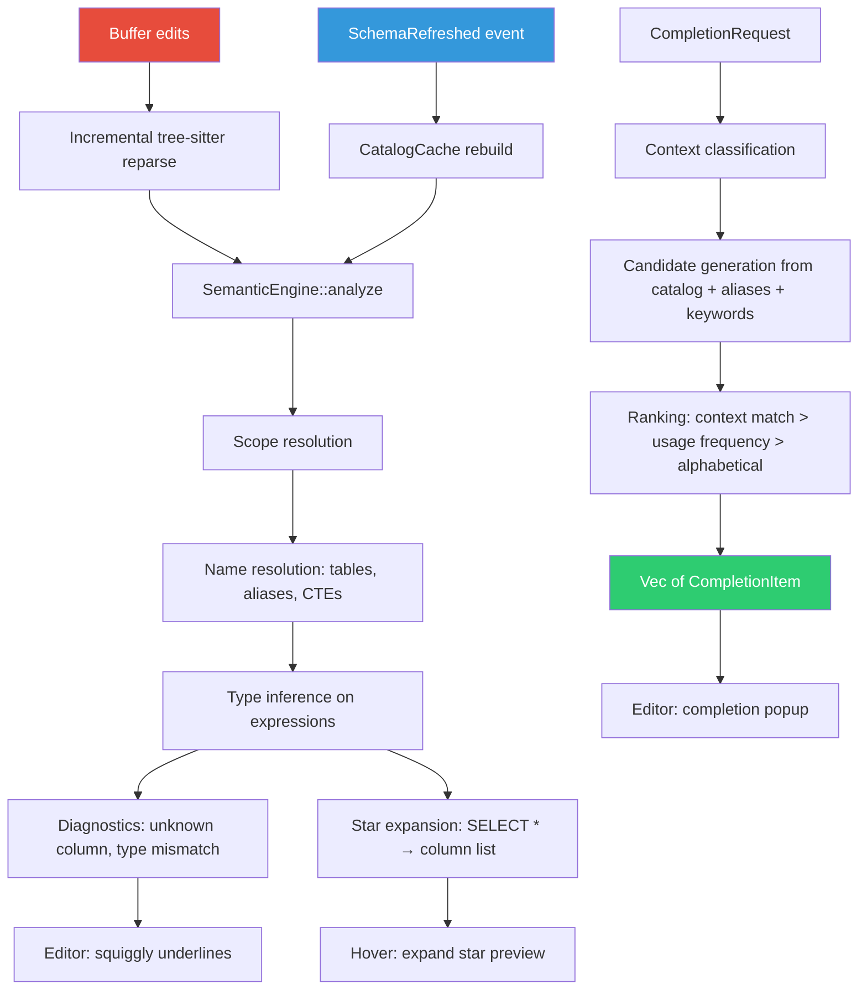
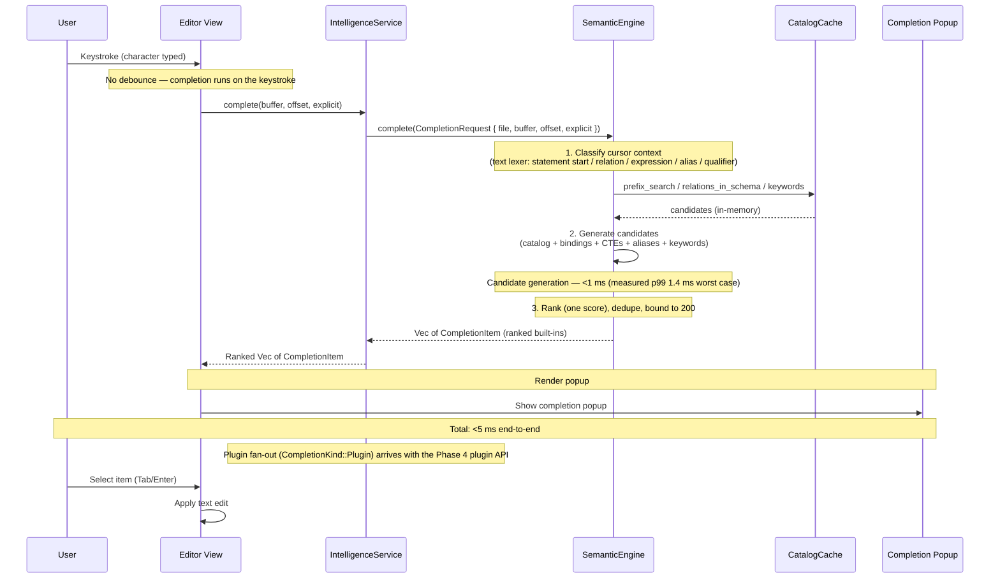
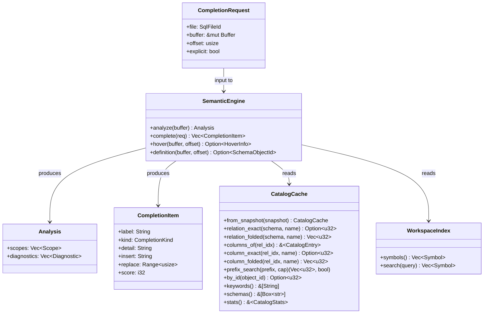

# SQL Intelligence

> The DataGrip half of Tempr — an internal semantic engine that resolves names, infers types, completes intelligently, and catches errors, all with zero I/O on the request path.

---

## Purpose

SQL intelligence is the core differentiator that elevates Tempr from "a fast SQL editor" to a true database IDE. It provides the semantic understanding of SQL that DataGrip pioneered — schema-aware completion, alias resolution, CTE scoping, type inference on comparisons, and diagnostic reporting — but implemented as an **internal semantic engine** running in-process, not as an external language server.

This is a locked architectural decision ([ADR-0009](adr/0009-internal-semantic-engine-not-lsp.md)): Tempr does **not** use an LSP subprocess for SQL intelligence. There is no separate process, no JSON-RPC hop, no serialized message exchange. The `SemanticEngine` has direct, in-memory access to the buffer's tree-sitter parse tree and to the workspace's `CatalogCache`. This eliminates two categories of latency that plague LSP-based tools — process startup and IPC serialization — and enables the <5 ms completion budget that makes typing in Tempr feel instantaneous.

The four inputs to the semantic engine are:

1. **Incremental parsing** — the tree-sitter SQL tree produced by the editor's `Buffer` ([10-editor.md](10-editor.md)). The tree is updated on every edit via incremental reparse, and the semantic engine consumes it directly without copying or serialization.

2. **Workspace cache** — symbol and index data maintained by the storage layer ([07-storage.md](07-storage.md)). Cross-file symbol resolution (e.g., completing a table defined in a different `.sql` file) reads from the pre-built workspace index, not by re-parsing every file.

3. **Semantic analysis** — name resolution, scope tracking, and type inference performed over the AST. This is the engine's own work: walking the tree-sitter nodes, resolving tables and aliases in scope at the cursor, handling CTEs and subqueries, and building the diagnostic model.

4. **Database metadata** — the `CatalogCache` built from `SchemaSnapshot` data provided by the database engine layer ([09-database-engine.md](09-database-engine.md)). The catalog is refreshed asynchronously via `SchemaRefreshed` events and held entirely in memory. The intelligence engine **never** queries the live database during completion or analysis — all metadata reads are sub-microsecond in-memory lookups.

---

## Responsibilities

This document governs:

- The `SemanticEngine` struct and its core API: `analyze`, `complete`, `hover`, `definition`.
- The semantic analysis pipeline: incremental scope resolution, alias tracking, CTE handling, subquery scoping, and star-expansion knowledge.
- The completion pipeline: context classification, candidate generation, ranking, and the <5 ms latency budget.
- Diagnostic generation: unknown column, ambiguous reference, type mismatch on comparison.
- The integration contract between the engine and plugin `CompletionProvider`s ([08-plugin-api.md](08-plugin-api.md)).
- The canonical types: `SemanticEngine`, `CatalogCache`, `CompletionRequest`, `CompletionItem`.

Out of scope:

- The editor buffer, tree-sitter grammar, and incremental parsing mechanics ([10-editor.md](10-editor.md)).
- The database driver, query execution, and schema snapshotting ([09-database-engine.md](09-database-engine.md)).
- The catalog cache persistence format and on-disk layout ([07-storage.md](07-storage.md)).
- Plugin lifecycle and registration mechanics ([08-plugin-api.md](08-plugin-api.md)).
- GPUI view-layer integration for displaying completions and diagnostics ([11-gpui.md](11-gpui.md)).

---

## Design Rationale

### Internal Engine vs External LSP

The decision to build an internal semantic engine rather than integrating an external LSP server was one of the earliest locked architectural choices. The tradeoffs are significant:

| Dimension | Internal Engine (Tempr) | External LSP (DataGrip, VS Code) |
|---|---|---|
| **Latency** | Sub-millisecond for in-memory operations. No process spawn, no IPC round-trip. Completion candidates resolve in <5 ms. | 50–200 ms typical (process startup + JSON-RPC serialization + response deserialization). First completion after idle can exceed 500 ms. |
| **DB-metadata access** | Direct in-memory read from `CatalogCache`. No serialization boundary. Schema snapshot is shared memory. | Requires IPC or a shared-memory protocol. Most LSP implementations re-query the database or cache metadata separately, introducing duplication. |
| **Multi-buffer context** | Full access to all open buffers, workspace symbols, and connection state. Cross-buffer completion (referencing a CTE defined in another file) is trivial. | LSP protocol is per-file. Cross-file context requires workspace-level extensions (`workspace/symbol`), which are inconsistently implemented and add latency. |
| **Protocol constraints** | No protocol. The engine's API is a Rust trait — types are checked at compile time, new methods are added without versioning. | LSP protocol is JSON-RPC over stdio. Every feature addition requires protocol version negotiation, `capabilities` advertisement, and serde round-tripping. |
| **Extensibility** | Plugin `CompletionProvider`s merge directly into the same ranked list. No separate registration protocol. | Plugins must implement the LSP client protocol or use a language-server-specific extension mechanism. |
| **Maintainability** | Single codebase, single language, single build. No separate language-server binary to ship, version, and debug. | Requires shipping a separate binary. Version mismatches between client and server cause hard-to-debug failures. |

The LSP approach has one advantage: it enables language-agnostic tooling (the same server powers multiple editors). Tempr is SQL-only — there is no second editor to serve — so this advantage does not apply.

### Why LSP Concepts Are Preserved as Internal API Shape

Despite rejecting the LSP protocol, the `SemanticEngine` API intentionally mirrors LSP concepts:

- `complete` returns `Vec<CompletionItem>` — the same type name LSP uses.
- `hover` returns `Option<HoverInfo>` — the same pattern as `textDocument/hover`.
- `definition` returns `Option<SchemaObjectId>` — analogous to `textDocument/definition`.

This is deliberate. Developers building plugins or contributing to Tempr already understand LSP vocabulary. Keeping familiar names reduces the learning curve without inheriting LSP's latency and protocol costs. The API shape is for human familiarity; the implementation is entirely internal.

---

## Interfaces

### SemanticEngine

The central type. Owned by `IntelligenceService` (stage 6), constructed once per workspace, and fed catalog updates via `set_catalog`. **Stages 4–6 shipped `analyze`, `complete` and `hover`**; `definition` is deferred (no file targets yet, docs/TODO.md). The sketch below reflects what exists today:

```rust
pub struct SemanticEngine {
    catalog: RwLock<Arc<CatalogCache>>,                 // parking_lot; swapped via set_catalog
    analyses: Mutex<HashMap<SqlFileId, CachedAnalysis>>,
}

impl SemanticEngine {
    /// Full semantic analysis of a buffer: scope trees, bindings and the
    /// diagnostics model. Cached per `SqlFileId`; the cache is validated by
    /// `Buffer::revision` — an integer compare, cheap on the request path.
    /// The `&mut` exists because Buffer's lazy reparse needs it (documented
    /// deviation from the spec's `&BufferSnapshot` sketch).
    pub fn analyze(&self, file: SqlFileId, buffer: &mut Buffer) -> Arc<Analysis>;

    /// Analysis keyed by the editor's source revision rather than the
    /// buffer's own counter. `IntelligenceService` analyzes a mirror buffer
    /// whose revision is unrelated to the view's, so diagnostics use this
    /// entry point and hover/completion hit the same cached analysis.
    pub fn analyze_at(
        &self,
        file: SqlFileId,
        source_revision: u64,
        buffer: &mut Buffer,
    ) -> Arc<Analysis>;

    /// Ranked completion candidates at the cursor (stage 5). Reads the same
    /// cached analysis and the immutable catalog; no I/O.
    pub fn complete(&self, req: CompletionRequest<'_>) -> Vec<CompletionItem>;

    /// Hover for the reference under `offset` (stage 6): relation, column,
    /// function or CTE card text plus the symbol's byte range. Reads the
    /// cached analysis and catalog; no I/O.
    pub fn hover(
        &self,
        file: SqlFileId,
        buffer: &mut Buffer,
        offset: usize,
    ) -> Option<HoverInfo>;

    /// A refresh built a new catalog cache; the analysis cache resets.
    pub fn set_catalog(&self, catalog: Arc<CatalogCache>);
    pub fn catalog(&self) -> Arc<CatalogCache>;
}
```

Three corrections to the spec's original sketch, recorded here and in the PROGRESS decisions log:

- **Cache key.** The spec claimed analysis caching validates by `EditId`. Undo recreates an earlier text state while reusing ids, so `EditId` cannot be the key. Tempr added `Buffer::revision` (re-assigned by every edit, undo and redo, untouched by failed edits); revision — not `EditId` — validates the cache. Revisions come from a process-wide counter, so a freshly opened `Buffer` for the same file never shares a revision with a previous instance and cannot hit its stale entry.
- **Catalog identity.** A cache entry also records the exact `Arc<CatalogCache>` it was built against, and a hit requires `Arc::ptr_eq` with the installed catalog. `set_catalog` clears the map, but an analysis already running on another thread could otherwise re-insert an entry whose arena indices point into the retired catalog; the pointer check makes that entry a guaranteed miss.
- **Borrow shape.** `analyze` takes `&mut Buffer`, not `&BufferSnapshot`. The workspace still has no `BufferSnapshot` type; the engine consumes the editor's `Buffer` directly, per the layout doc's grouping of editor and intelligence layers.
- **Hot path scope.** `complete` and `hover` prefer a cached full analysis for the revision (diagnostics usually produced it). On a miss they walk only the top-level statement(s) containing the cursor — plus the statement an incomplete trailing fragment trails — which is all `scope_chain` and `frame_chain` need. A 500-statement typing probe keeps p50 at 0.4 ms (p99 3.1 ms), instead of scaling with file length on every keystroke.

The walk is two-phase per region so clause order cannot mislead visibility: phase A collects all of the region's bindings (CTEs in declaration order, FROM/JOIN sources, `UPDATE`/`INSERT` targets, the `DELETE` target that the grammar keeps in the statement-level `from` sibling, `LATERAL (subquery)` and `LATERAL function(…)` aliases — `lateral_join` and `lateral_cross_join` are distinct nodes) *without analyzing any subquery body*; phase B analyzes every subquery and CTE body after the region's frame is complete, so a `select`-list subquery still sees a `FROM` alias appearing later in the source. A **region is its container node** (`statement`, `subquery`, `set_operation`), not the `select` node — the grammar keeps `select`, `from`, `where`, … as siblings, so selecting only the `select` would drop every binding and predicate. `set_operation` statements scope per `select` side and its clause siblings (merging sides' bindings would invent ambiguity the server does not see). CTE bodies see only earlier CTEs; a `WITH RECURSIVE` self-reference resolves with no column knowledge and stays silent. Column qualifiers follow PostgreSQL: an alias hides the source's own name, and a schema never answers a two-part qualifier (three-part names resolve through the catalog). FROM-subquery/lateral-subquery columns derive from the body's top select list, so derived-table references are checked like any other binding.

The completion, hover and definition signatures (`complete`, `hover`, `definition`) were sketched on a `&BufferSnapshot` that never materialised. Stage 5 shipped `complete` on the real `Buffer` (again `&mut`, for the analysis cache's lazy reparse) and stage 6 did the same for `hover`; `definition` remains deferred because there are no file targets yet. There is no separate snapshot type.

Hover resolves the reference under the cursor against that same analysis. A bare column follows the analyzer's nearest-level rule: the innermost scope with any match decides, so an inner `id` is not reported as ambiguous with an outer `id`. A dotted path longer than a relation (`db.schema.rel.col`) qualifies the relation by its **last two** path segments, ignoring any database prefix. Byte offsets that land inside a multi-byte character produce no reference rather than slicing invalid UTF-8.

### CompletionRequest

The input to the completion pipeline. Constructed by `IntelligenceService` on every completion trigger (an identifier character or qualifier dot, or an explicit `ctrl-space` request). **Shipped shape (stage 5):**

```rust
pub struct CompletionRequest<'a> {
    /// The buffer being completed. `&mut` because the analysis cache lazily
    /// reparses; completion only reads text and analysis.
    pub file: SqlFileId,
    pub buffer: &'a mut Buffer,

    /// Byte offset of the cursor within the buffer.
    pub offset: usize,

    /// True for ctrl-space: bypasses the auto-open gating.
    pub explicit: bool,
}
```

Multi-connection workspaces are not solved yet: the engine holds a single catalog, and `IntelligenceService` swaps it on any connection's `SchemaRefreshed`. One engine per live connection (and gating analyses by connection) is parked in docs/TODO.md.

### CompletionItem

A single ranked candidate. **Shipped shape (stage 5):**

```rust
pub struct CompletionItem {
    /// Text shown in the popup.
    pub label: String,
    pub kind: CompletionKind,
    /// Type, signature, schema or ownership hint (empty when there is none).
    pub detail: String,
    /// Text the editor writes. Usually `label`, but a name PostgreSQL would
    /// fold differently (e.g. `createdAt`) arrives quoted (`"createdAt"`).
    pub insert: String,
    /// Byte range the item replaces (the word under the cursor).
    pub replace: Range<usize>,
    /// Ranking score, highest first.
    pub score: i32,
}

pub enum CompletionKind {
    Keyword, Table, Column, Schema, Alias, Cte, Function, Snippet, Plugin,
}
```

Views use `CompletionKind::Table` with `detail: "view · public"` (the canonical enum has no `View` variant). Plugin fan-out (`CompletionKind::Plugin`) arrives with the plugin API in Phase 4; stage 6 merges built-in items only.

### Analysis

The result of a full semantic analysis pass over a buffer. **Shipped shape (stages 4–6):**

```rust
pub struct Analysis {
    /// Top-level statement scopes, in byte order. Children carry subquery and
    /// CTE frames plus the bindings each region exposes.
    pub scopes: Vec<Scope>,

    /// Sorted by (byte order, errors before warnings) by the engine.
    pub diagnostics: Vec<Diagnostic>,
}

impl Analysis {
    /// Diagnostics overlapping `query`, already severity-ordered.
    pub fn diagnostics_in(&self, query: Range<usize>) -> Vec<&Diagnostic>;

    /// Next diagnostic at or after `from` (f8).
    pub fn next_diagnostic(&self, from: usize) -> Option<&Diagnostic>;

    /// Last diagnostic strictly before `from` (shift-f8).
    pub fn previous_diagnostic(&self, from: usize) -> Option<&Diagnostic>;

    /// Scopes containing `offset`, outermost first.
    pub fn scope_chain(&self, offset: usize) -> Vec<&Scope>;
}

pub struct Diagnostic {
    pub range: Range<usize>,
    pub kind: DiagnosticKind,       // SyntaxError | UnknownRelation | UnknownColumn | AmbiguousColumn
    pub severity: Severity,         // Warning | Error
    pub message: String,
}
```

Star-expansion knowledge is **not** in `Analysis` yet: hover shows a relation's column list from the catalog, and expanding `*` into an explicit list is future work (docs/TODO.md). Type mismatch is likewise unimplemented.

### HoverInfo

**Shipped shape (stage 6):**

```rust
pub struct HoverInfo {
    /// Plain-text card contents (`\n`-separated lines).
    pub contents: String,

    /// Byte range of the symbol under the cursor.
    pub range: Range<usize>,
}
```

A relation name (including a bare relation in `FROM`) resolves to its richer relation card (schema, estimated rows, column list); aliases and CTEs resolve to their binding card. Markdown is not parsed — the card renders one `div` per line.

---

## Data Flow

### Semantic Analysis Dataflow

The following diagram shows how buffer edits and schema refresh events flow through the semantic engine to produce diagnostics, completions, and hover information:



### Completion Request Sequence

The following sequence diagram shows the completion pipeline from keystroke to popup, with the <5 ms latency budget annotated at each stage:



### Scope Resolution Walk

The semantic analyzer walks the tree-sitter AST to build a scope chain. Each scope tracks visible tables, aliases, and CTEs. The resolution algorithm:

1. **Start at the root node.** The root scope has no parent and contains only the database-level objects from the `CatalogCache` (schemas, tables, views, functions).

2. **Enter a FROM clause.** When the walker enters `SELECT ... FROM table_name AS alias`, it resolves `table_name` against the catalog, creates an alias binding, and pushes a new scope. All column references in the SELECT list that are unqualified resolve against this scope.

3. **Enter a CTE (WITH clause).** When the walker encounters `WITH cte_name AS (SELECT ...)`, it records the CTE name in the current scope. The CTE's column list is inferred from its body's SELECT list. Columns from the CTE are available in the outer query via the CTE name or its optional alias.

4. **Enter a subquery.** Subqueries create a new child scope. The subquery can see its parent scope's tables (unless the subquery is in a FROM clause, in which case it creates a new scope chain). Lateral joins are recognized and handled specially — the right side of a LATERAL join can reference columns from the left side.

5. **Star expansion.** When `SELECT *` or `SELECT t.*` is encountered, the analyzer resolves the star against the current scope's visible tables. The result is a list of `(column_name, table_alias, type)` tuples that the editor can display on hover or use for type inference.

---

## Semantic Analysis Detail

### Name Resolution

The walk compares names with any surrounding double quotes removed (`"createdAt"` denotes `createdAt`, and `""` inside is one literal quote). The comparisons below still fold case, so quoted case sensitivity is not enforced yet (parked in docs/TODO.md).

The engine resolves names in three steps:

1. **Unqualified name** (e.g., `column_name`): Walk up the scope chain looking for a table or alias that contains a column with this name. If exactly one match is found, the reference is resolved. If zero matches are found, emit `DiagnosticCode::UnknownColumn`. If multiple matches are found, emit `DiagnosticCode::AmbiguousReference`.

2. **Qualified name** (e.g., `t.column_name`): Look up the qualifier `t` in the current scope. If `t` is an alias, resolve it to the underlying table and look up `column_name` in that table's column list. If `t` is a schema-qualified name (e.g., `public.users`), resolve via the catalog's schema → table → column hierarchy.

3. **Star expression** (`*` or `t.*`): Expand against all visible tables in scope (for `*`) or against the specific table (for `t.*`). Record the expansion for hover display and type inference.

### CTE Scope Handling

Common Table Expressions (CTEs) are treated as named subqueries that inject into the enclosing scope:

- A CTE defined in a `WITH` clause is visible to all subsequent CTEs in the same `WITH` and to the main query.
- The column list of a CTE is inferred from its body's SELECT list (including aliases applied within the CTE).
- Recursive CTEs (`WITH RECURSIVE`) are recognized — the recursive reference is available within the CTE body itself.
- CTEs can shadow table names (a CTE named `users` takes precedence over the `users` table in the catalog).

### Subquery Scoping

Subqueries in WHERE, HAVING, and FROM clauses each create a distinct scope:

- **WHERE subquery**: `WHERE x IN (SELECT ...)`. The inner query can reference tables from the outer query (correlated subquery). The engine tracks correlation by recording which outer-scope names the inner query references.
- **FROM subquery**: `FROM (SELECT ...) AS sub`. The inner query's result columns become the subquery's visible columns. The alias (`sub`) is bound in the parent scope.
- **LATERAL subquery**: `FROM t, LATERAL (SELECT ... FROM t2 WHERE t2.id = t.fk)`. Lateral subqueries can reference columns from preceding FROM items. The engine handles this by keeping preceding FROM items in scope during lateral subquery analysis.

### Star-Expansion Knowledge

The engine does not yet maintain a star-expansion map (deferred; docs/TODO.md). Once it does, it enables:

- **Hover on `*`**: Show a tooltip listing all columns that `*` would produce, with types.
- **Hover on `t.*`**: Show the columns of table `t` specifically.
- **Type inference**: When `SELECT *` is expanded, each column's type is known, enabling downstream type checking on comparisons and aggregations.

### Diagnostics

The semantic analysis produces three categories of diagnostics (v1 ships the first two; type mismatch is not implemented):

| Diagnostic | Trigger | Example |
|---|---|---|
| **Unknown column** | A column name is used that does not match any table in scope. | `SELECT nonexistent FROM users` — `nonexistent` is flagged. |
| **Ambiguous reference** | An unqualified column name matches columns in multiple tables in scope. | `SELECT id FROM users JOIN orders ON ...` — `id` exists in both `users` and `orders`. |
| **Type mismatch** | A comparison or assignment uses incompatible types. | `WHERE name > 42` — `name` is `text`, `42` is `integer`. |

The type-mismatch diagnostic is intentionally conservative for v1. It catches obvious mismatches (string vs integer, boolean vs timestamp) but does not attempt full type-system soundness. The depth of type inference is an open question (see [Open Questions](#open-questions)).

---

## Interfaces — Mermaid Diagram

### SemanticEngine Type Relationships



---

### Shipped catalog cache (`tempr_intel::CatalogCache`, Phase 3 stage 3)

The catalog cache is an immutable, resolution-shaped arena built from one `SchemaSnapshot` (`CatalogCache::from_snapshot`): relations first, then functions, then columns grouped contiguously per relation in `ordinal` order, then indexes — every map holds `u32` arena indices, so "columns of this table" is a slice, not a scan. An unquoted SQL identifier folds to lower case (the `*_folded` lookups return a candidate list — coexisting `users` and quoted `"Users"` is ambiguity the *analyzer* reports, never guessed in the cache); a quoted identifier matches through the case-sensitive `*_exact` lookups. `prefix_search` runs over relation and function names via binary search on the folded `name_order`, capped with an overflow flag for the completion top-N heap. The structure is rebuilt wholesale per refresh and swapped behind an `Arc` when the `SemanticEngine` is told to `set_catalog`; readers never see a half-updated catalog. Probe numbers live in `PROGRESS.md`'s session log: on a ~10 000-object synthetic catalog, the request-shape mix (`prefix_search` + `relation_folded` + `columns_of` + `column_folded`) costs p95 ≈ 0.002 ms — far inside the < 5 ms completion budget it shares with context classification, ranking and rendering.

## Completion Pipeline

The completion pipeline is the most latency-sensitive path in the entire system. It runs on every completing keystroke (no debounce) and must return results before the user perceives a delay.

### Stage 1: Context Classification

**Shipped (stage 5): text, not tree nodes.** A small forward lexer reads the current statement's text (line and nested block comments, `'…''…'` strings, `$tag$…$tag$` bodies and `"quoted identifiers"` are skipped) and classification looks at the last token; a backward scan at the cursor recovers the word being replaced and any qualifier path. The tree is *not* consulted for clauses: the stage-5 probe found a trailing incomplete clause leaves the statement as a top-level `ERROR` sibling (`select * from ` → `(statement …) (ERROR (keyword_from))`), so tree shape is unreliable exactly while the user types. The stage-4 analysis still supplies the scopes (bindings, CTEs) that candidates come from.

| Context | Text pattern | Candidates |
|---|---|---|
| **Statement start** | Nothing before the cursor, or a complete `WITH …` clause. | Statement keywords (`SELECT`, `INSERT`, `WITH`, `CREATE`, …). |
| **Relation** | After `FROM`/`JOIN`/`UPDATE`/`INTO`/`TABLE`/`TRUNCATE`/`ONLY`, or after a comma at paren depth 0 whose nearest clause is one of those. | CTEs, tables/views, schema names. |
| **Expression** | Any other position (`SELECT` list, predicates, arguments, after `=`, after `WHERE`/`ON`/`SET`/`VALUES`). | Columns in scope (weighted up), relations, functions, keywords, aliases. |
| **Alias** | After `AS` or `WITH`. | None — the user names aliases and CTEs. |
| **Qualifier** | After a dot: `u.`, `public.`, `public.users.` (whitespace tolerated). | Columns of that binding/CTE; relations of that schema; columns of a schema-qualified relation. |

Auto-open follows spec decision 5: one identifier character or a qualifier dot opens the popup; `ctrl-space` (`explicit`) forces it anywhere.

Identifier candidates are inserted the way PostgreSQL will read them back: a name outside the unquoted `[a-z_][a-z0-9_$]*` shape (or a reserved word) gets double quotes, so accepting `createdAt` writes `"createdAt"` rather than the folded `createdat` that names a different column. The analyzer strips those quotes before resolving a reference; quoted-context case sensitivity is parked in docs/TODO.md.

### Stage 2: Candidate Generation

**Shipped (stage 5):**

1. **Catalog lookup** — relations and functions come from `CatalogCache::prefix_search` (binary search over the folded `name_order`, capped at 200); a schema dot uses `relations_in_schema`. Column candidates come from the visible bindings' column lists (arena slices for real relations, derived names for CTEs/FROM-subqueries), never from a catalog-wide scan.

2. **Scope resolution** — the cursor's `Analysis::scope_chain` gives the innermost frame and its correlated ancestors; a trailing `ERROR` fragment falls back to the statement it trails so a half-typed `where ` keeps its bindings. Bare columns are offered when their folded name is unique across visible bindings; a repeated name is offered qualified (`alias.col`) instead.

3. **Keyword list** — the server's `pg_get_keywords()` list (cached with the snapshot, uppercased for display) when a catalog is loaded; the static fallback list otherwise (spec §7: no catalog → keywords only). Statement starts use the static statement-keyword set because the server list is unordered and includes non-statement words.

4. **Workspace index** — not shipped (no file-open flow yet); the generator is a single seam so it can be added as another candidate source.

### Stage 3: Ranking

**Shipped (stage 5)** — one integer, exactly as spec §5.2 describes:

`score = context_weight * 1000 + match_quality * 4 - label.chars().count()`

Context weights: column 500, qualified column 480, CTE 470, relation 450, statement keyword 400, function 300, relation-in-expression 250, schema 200, alias 150, keyword 100. Match quality: exact prefix 400 > folded prefix 300 > `fuzzy_match` score (the palette matcher, now `tempr_domain::text`); ties break on the shorter label and then alphabetically, so output is deterministic. Duplicates are deduped by `(label, kind)` keeping the highest score, and a bounded 200-item heap keeps only the best candidates.

**Not shipped:** usage-frequency boosting from query history (docs below describe it as the second tier; it lands with the Phase 4 history panel). Cross-file workspace symbols are likewise future work.

---

## Latency Budget

The <5 ms completion budget is a **hard requirement**, not a soft target. It is achieved through three architectural constraints:

| Constraint | How it helps |
|---|---|
| **In-memory catalog arena** | `CatalogCache` is an immutable `Vec<CatalogEntry>` with `u32` indices in every map; columns of a relation are a contiguous slice and prefix search is a binary search over a folded name order. No string comparison against the server, no re-sorting per request. |
| **No I/O on the request path** | The completion pipeline never performs disk reads, network calls, or subprocess invocations. All data sources (catalog, keyword list, analysis) are pre-loaded and held in memory. Schema refresh happens asynchronously in the background; completion reads a consistent `Arc` snapshot. |
| **Cached analysis** | `analyze` runs once per `Buffer::revision` and is cached per `SqlFileId`; a completion request after the first keystroke is an integer compare plus candidate generation. (Whole-buffer re-analysis per edit, not incremental regions — the revision cache is what keeps the request path cheap.) |

Measured budget breakdown for a typical completion request (release, synthetic 10 000-object catalog — 1 200 relations × 8 columns, 1 200 indexes, 800 functions; stage-5 probe, 40 warm runs per case):

| Case | p50 | p95 | p99 | max |
|---|---|---|---|---|
| Relation prefix (200 of 1 200 relations) | 0.070 ms | 0.081 ms | 0.091 ms | 0.091 ms |
| Expression column prefix | 0.002 ms | 0.002 ms | 0.003 ms | 0.003 ms |
| Qualifier dot (one binding's columns) | 0.008 ms | 0.009 ms | 0.010 ms | 0.010 ms |
| Schema dot (all relations of a schema) | 1.109 ms | 1.125 ms | 1.138 ms | 1.138 ms |
| ctrl-space, empty relation prefix | 0.004 ms | 0.005 ms | 0.010 ms | 0.010 ms |
| Function prefix | 0.004 ms | 0.005 ms | 0.005 ms | 0.005 ms |

Cold (first request per buffer, including the parse + analysis) stayed under 1.7 ms in every case. The **< 5 ms** budget holds with margin; the schema-dot case is the heaviest because it materialises every relation of the schema before ranking.

If profiling reveals that any stage consistently exceeds its budget, the engine must be optimized — the budget is not negotiable.

---

## Data Flow

### Analysis on Buffer Edit

The buffer belongs to `EditorView`, so analysis is view-driven rather than event-driven in stage 6:

1. **The edit applies** to the rope and triggers tree-sitter's incremental reparse inside `Buffer`.

2. **`EditorEvent::Changed`** is emitted; `MainWindow` publishes `AppEvent::BufferChanged { file }` for any other observer.

3. **`EditorView` debounces** for 100 ms (`cx.spawn` + the background executor's timer). If the buffer's revision changed while waiting, the pass is dropped — the newest revision wins.

4. **The view sends an immutable text snapshot** to `IntelligenceService::analyze(file, source_revision, &text)` on tokio. The service keeps one mirror `Buffer` per file, applied as a single minimal replacement so tree-sitter stays incremental, and calls `SemanticEngine::analyze` on it. The mirror exists precisely because the real buffer cannot leave the UI thread and `analyze` needs `&mut Buffer`.

5. **The service caches** `(source_revision, Arc<Analysis>)` and publishes `DiagnosticsReady { file }`.

6. **The view pulls the result** on the main thread via `IntelligenceService::analysis(file, buffer.revision())`. A revision mismatch is a miss: stale analysis is never rendered. The status bar then shows `N errors · M warnings`.

Completion and hover remain synchronous UI-thread calls: `IntelligenceService::complete` / `hover` take the live `&mut Buffer` and return immediately (no I/O, no locks beyond the catalog `Arc`), per spec decision 7.

### UI surfaces (stage 6)

- **Completion popup.** Caret-anchored (`anchored()` at the caret's window point), at most 12 visible rows in a `uniform_list`, each with label, kind and detail. It opens automatically after an identifier character or a qualifier dot and on `ctrl-space`; typing re-filters and keeps the selected label when it survives. `enter`/`tab` replace the item's `replace` range with `insert` and put the caret after it; `escape` dismisses; `down`/`up` and `ctrl-n`/`ctrl-p` move with wrap and scroll the selection into view. While open, the editor's key context is `Editor Completion`, and the four `completion::*` commands are hidden from palette search so a closed popup can never consume `enter`/`tab`/`escape`.
- **Diagnostic underlines.** `runs_for_line` tracks `(color, underline)` per byte for the visible diagnostics only: errors are solid `theme::ERROR`, warnings wavy `theme::WARNING`, and an error wins where the two overlap.
- **Hover card.** `ctrl-k ctrl-i` resolves the reference at the primary cursor; with no symbol it shows the diagnostic under the cursor instead, and with neither it emits a status notice. Any edit or motion closes the card.
- **Diagnostic navigation.** `f8` / `shift-f8` walk `next_diagnostic` / `previous_diagnostic`, skipping the diagnostic under the cursor, wrapping at the ends, moving the caret to `range.start` and showing the message card after the frame that scrolls it into view.

### Schema Refresh Integration

When a `SchemaRefreshed` event arrives:

1. **CatalogCache** is rebuilt from the new `SchemaSnapshot`. This is a background operation — completion requests during the rebuild continue using the old catalog (stale but consistent).

2. **SemanticEngine** receives notification that the catalog changed (`set_catalog`). It swaps the `Arc<CatalogCache>` and clears every cached `Analysis` — all resolution results are catalog-dependent.

3. **Next completion request** uses the new catalog. The transition is seamless — the user sees no flicker or interruption.

On `ConnectionStateChanged { Connected }` the service loads the persisted `.tcat` cache first (offline catalog before the network), then runs `refresh_incremental`. A failed refresh publishes `SchemaRefreshFailed` and leaves the previous catalog installed. The UI's `schema::Refresh`, `schema::RefreshIncremental` and `schema::RefreshAllSchemas` commands run the same service paths on tokio and report object counts or the refresh path in the status bar.

---

## Future Considerations

### Quick-Fixes and Refactoring

The semantic engine's analysis output enables IDE-quality refactoring operations:

- **Rename alias** — when the user invokes rename on an alias (`FROM users AS u`), the engine can find all references to `u.` in the query and replace them atomically. The scope analysis already tracks alias bindings and their usage sites.

- **Expand star** — when the user invokes "expand star" on `SELECT *`, the engine replaces `*` with the explicit column list derived from star-expansion knowledge. This is the inverse of what the hover already shows.

- **Add table to FROM** — when the user types a column name that does not exist in the current scope, a quick-fix could suggest adding the table that owns that column to the FROM clause.

- **Inline CTE** — a refactoring that replaces a CTE reference with its definition body, useful for simplifying queries during debugging.

These are deferred to post-v1 but the analysis infrastructure (scope resolution, star expansion, alias tracking) is built to support them.

### Cross-Dialect Analysis

When MySQL and SQLite drivers land ([09-database-engine.md](09-database-engine.md)), the semantic engine will need to handle dialect-specific syntax:

- **Reserved words differ** — `INTERVAL` is a keyword in PostgreSQL but a regular identifier in MySQL. The keyword completion list must be filtered by the active connection's dialect.
- **Type system differences** — PostgreSQL's `jsonb` vs MySQL's `JSON` vs SQLite's type affinity. The type-mismatch diagnostic must understand per-dialect type compatibility.
- **Function signatures differ** — `GROUP_CONCAT` (MySQL) vs `STRING_AGG` (PostgreSQL) vs `GROUP_CONCAT` (SQLite). Function completion must be dialect-aware.

The current architecture supports this by parameterizing the `SemanticEngine` on a `Dialect` trait that provides reserved words, type compatibility rules, and function catalogs.

### AI Provider Integration Point

The semantic engine's analysis output is a natural input for AI-powered SQL assistance. A future `AiProvider` ([08-plugin-api.md](08-plugin-api.md)) could receive:

- The current `Analysis` (scopes, diagnostics, star expansions).
- The `CatalogCache` snapshot (table/column metadata).
- The user's natural-language prompt (e.g., "write a query to find active users").

The engine would serialize the relevant context into a prompt and pass it to the AI provider. The AI's response would be streamed back as a `CompletionItem` with `CompletionKind::Snippet`, blending AI-generated SQL with the existing completion pipeline.

---

## Open Questions

| # | Question | Status | Notes |
|---|---|---|---|
| 1 | **Type inference depth for v1.** How deep should the type inference go? Full type inference (tracking `INT + INT → INT`, `STRING \|\| STRING → STRING`, `INT + STRING → error`) is complex and may not justify its implementation cost for v1. Current leaning: infer types only for column references (from catalog metadata) and for literal expressions. Comparison type-mismatch detection uses column types only — it does not infer types of complex expressions. | Open | Full expression-level type inference is valuable for aggregate functions (`COUNT` always returns `BIGINT`, `SUM` of `INT` returns `BIGINT`) but the implementation cost is non-trivial. The v1 diagnostic for type mismatch on simple comparisons (`WHERE name > 42`) already delivers significant value. Expression-level inference is a post-v1 enhancement. |
| 2 | **Dialect abstraction for the analyzer.** How should dialect-specific behavior (reserved words, function signatures, type compatibility) be abstracted? Options: (a) a `Dialect` trait with Postgres/MySQL/SQLite implementations, selected by the active connection; (b) a single dialect-aware data structure loaded from a configuration file; (c) per-dialect crates. | Open | Option (a) is cleanest — the `SemanticEngine` holds a `dyn Dialect` reference injected at construction. The dialect provides `is_reserved(word)`, `type_compatible(from, to)`, and `functions()`. The Postgres dialect is the v1 implementation; MySQL and SQLite dialects are stubs. Option (b) is simpler but less extensible. Option (c) adds build complexity without clear benefit. |
| 3 | **Completion caching.** Should completed results be cached per (buffer_version, offset) to avoid recomputation when the user navigates away and back to the same position? The current implementation recomputes on every request. | Open | For most queries (under 500 lines), recomputation is under 1 ms and caching adds complexity (cache invalidation on every edit). For very large files (thousands of lines), caching could help. Recommend measuring on real-world large queries before deciding. |
| 4 | **Multi-cursor completion.** When the user has multiple cursors and triggers completion, should each cursor get independent candidates (based on its own scope context), or should all cursors share the same candidate list? | Open | Independent candidates are correct but require running the completion pipeline N times. For 2–3 cursors this is fine. For many cursors, the combined latency could exceed the 5 ms budget. Recommend independent for ≤3 cursors, shared for more. |

---

## Related Documents

- [Editor](10-editor.md) — the buffer, tree-sitter incremental parsing, and `BufferChanged` events that feed the semantic engine.
- [Database Engine](09-database-engine.md) — `SchemaSnapshot`, `CatalogCache`, and the metadata pipeline that provides schema data to the intelligence engine.
- [Storage](07-storage.md) — `CatalogCache` persistence, workspace index, and the on-disk cache format.
- [Plugin API](08-plugin-api.md) — `CompletionProvider` trait, plugin fan-out, and the registration model for third-party completion sources.
- [ADR-0009](adr/0009-internal-semantic-engine-not-lsp.md) — the locked decision to build an internal semantic engine rather than using an external LSP server.
